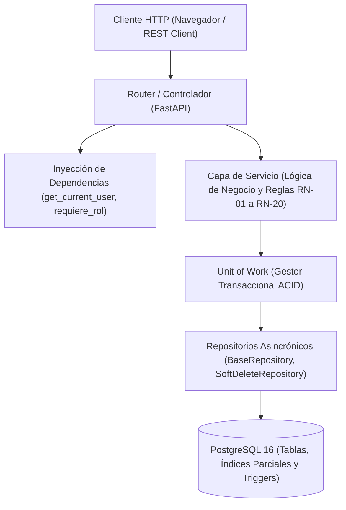

# Taller Mecánico API — Sistema de Gestión Integral

[](https://www.python.org/downloads/)
[](https://fastapi.tiangolo.com/)
[](https://sqlmodel.tiangolo.com/)
[](https://www.postgresql.org/)
[](https://alembic.sqlalchemy.org/)
[]()

Backend asincrónico para la gestión de un taller mecánico automotriz, desarrollado para el **Trabajo Práctico (Capítulos 1 a 6)** de la cátedra de Programación.

La API implementa un modelo de dominio completo con autenticación segura, control de acceso basado en roles dinámico (RBAC), gestión de clientes, vehículos, repuestos, inventario con movimientos auditados, ciclo de vida de órdenes de trabajo, cálculo transaccional de totales y disparadores de base de datos para tablas de sólo agregado (*append-only*).

---

## Índice

1. [Características Principales](#-características-principales)
2. [Stack Tecnológico](#-stack-tecnológico)
3. [Arquitectura y Patrones](#-arquitectura-y-patrones)
4. [Estructura del Proyecto](#-estructura-del-proyecto)
5. [Puesta en Marcha](#-puesta-en-marcha)
   - [Requisitos Previos](#requisitos-previos)
   - [Instalación y Configuración](#instalación-y-configuración)
   - [Migraciones de Base de Datos](#migraciones-de-base-de-datos)
   - [Poblado Inicial Canónico (Seed)](#poblado-inicial-canónico-seed)
   - [Ejecución del Servidor](#ejecución-del-servidor)
6. [Usuarios y Credenciales de Prueba](#-usuarios-y-credenciales-de-prueba)
7. [Suite de Pruebas y Verificación](#-suite-de-pruebas-y-verificación)
   - [Pruebas Automatizadas (Pytest)](#pruebas-automatizadas-pytest)
   - [Pruebas Interactivas (.http) y C-01 a C-19](#pruebas-interactivas-http-y-c-01-a-c-19)
   - [Disparadores Inmutables SQL](#disparadores-inmutables-sql)
8. [Matriz de Casos Oficiales y Reglas de Negocio](#-matriz-de-casos-oficiales-y-reglas-de-negocio)
9. [Roadmap de Changes Implementados](#-roadmap-de-changes-implementados)

---

## 🚀 Características Principales

- **Arquitectura en 6 Capas**: Separación estricta de responsabilidades entre Routers, Servicios, Unit of Work, Repositorios, Modelos de Datos y Esquemas DTO.
- **Autenticación Robusta**:
  - Emisión y verificación de tokens JWT (`HS256`) transportados exclusivamente en cookies seguras (`HttpOnly`, `SameSite=Lax`).
  - Hashing con `bcrypt` ejecutado fuera del bucle de eventos asincrónico (`asyncio.to_thread`) protegido por semáforo de concurrencia.
  - Mitigación de *timing attacks* mediante cálculo contra hash ficticio determinístico cuando el usuario no existe.
  - Protección contra fuerza bruta con limitación de tasa (HTTP 429 `Retry-After` tras 5 intentos fallidos en 60 segundos) y auditoría en transacción independiente.
  - Invalidación inmediata de tokens comparando microsegundos contra cambios de contraseña.
- **Autorización y RBAC Dinámico en Base de Datos**:
  - Roles (`ADMIN`, `RECEPCION`, `MECANICO`, `CLIENTE`) con vigencia temporal (`desde`, `hasta`) consultados directamente en DB.
  - Reglas de autoprotección: un administrador no puede auto-revocarse el rol ni revocar al último administrador activo del sistema.
  - Forzado de cambio de contraseña inicial para cuentas nuevas o reseteadas.
- **Gestión de Clientes y Vehículos**:
  - Auto-registro atómico de clientes con creación concurrente de usuario y ficha de cliente bajo UoW.
  - Borrado lógico (*soft delete*) de vehículos con índice parcial en PostgreSQL para permitir re-alta de patentes transferidas.
  - Validación de integridad que impide eliminar vehículos con órdenes abiertas (`PENDIENTE` o `EN_REPARACION`).
  - Endpoint de autoservicio `/mis-vehiculos` con aislamiento estricto por cliente autenticado.
- **Gestión de Repuestos y Control de Stock**:
  - Alta de repuestos con movimiento de stock inicial atómico.
  - Ajuste de stock únicamente mediante reposición documentada; rechazo en esquemas `PATCH` (HTTP 422).
  - Trazabilidad y versionado histórico de precios en `historial_precio_repuesto`.
- **Órdenes de Trabajo y Tareas en Segundo Plano**:
  - Máquina de estados estricta: `PENDIENTE` $\rightarrow$ `EN_REPARACION` $\rightarrow$ `TERMINADA` o `CANCELADA`.
  - Copiado inmutable de precios unitarios al momento de agregar ítems a la orden; cálculo seguro de subtotales y totales con precisión `Decimal` / `NUMERIC(12,2)`.
  - Reserva y descuento atómico de stock al iniciar o finalizar reparaciones con validación de inventario suficiente.
  - Notificaciones al cliente simuladas de forma asincrónica con `fastapi.BackgroundTasks`.
  - Aislamiento en `/mis-ordenes` y precedencia estricta de validaciones (403 Forbidden antes de 409 Conflict).
- **Tablas de Sólo Agregado (*Append-Only*)**:
  - Disparadores PL/pgSQL en PostgreSQL que abortan cualquier sentencia `UPDATE` o `DELETE` sobre las tablas históricas `historial_estado_orden`, `movimiento_stock` e `historial_precio_repuesto`.

---

## 🛠 Stack Tecnológico

| Componente | Versión | Uso en el Sistema |
|---|---|---|
| **Python** | 3.12+ | Lenguaje base con soporte asincrónico moderno y tipado estricto. |
| **FastAPI** | 0.111+ | Framework web ASGI; todos los handlers son funciones `async def`. |
| **SQLModel** | 0.0.24 | ORM que unifica modelos relacionales SQLAlchemy y esquemas Pydantic. |
| **SQLAlchemy** | 2.0+ (async) | Acceso a datos relacional, sesiones `AsyncSession` y precarga `selectinload`. |
| **asyncpg** | 0.30+ | Driver nativo asincrónico de alto rendimiento para PostgreSQL. |
| **PostgreSQL** | 16 | Motor de base de datos relacional ACID con soporte de triggers PL/pgSQL. |
| **Alembic** | 1.13+ | Versionado y migraciones de esquema con soporte asincrónico. |
| **pydantic-settings** | 2.0+ | Gestión tipada de variables de entorno mediante clase `Settings`. |
| **bcrypt** | 4.0+ | Hashing de contraseñas fuera del event loop. |
| **PyJWT** | 2.8+ | Emisión y validación de tokens JSON Web Token firmados (`HS256`). |
| **uvicorn** | standard | Servidor ASGI para ejecución en desarrollo y producción. |
| **pytest / pytest-asyncio** | 8.0+ | Suite de pruebas automatizadas asincrónicas y cliente de prueba `httpx`. |

---

## 🏛 Arquitectura y Patrones

El sistema adopta una arquitectura desacoplada y orientada al dominio:



### Reglas de Diseño Fundamentales

1. **Unit of Work**: Los repositorios **nunca** ejecutan `commit()`, únicamente invocan `flush()`. El control transaccional es responsabilidad exclusiva del gestor de contexto `async with uow:`.
2. **Eager Loading Obligatorio**: Todas las consultas que leen entidades con relaciones utilizan `selectinload` para garantizar un número constante de consultas y eliminar el problema de consultas N+1.
3. **Contratos Pydantic Estrictos**: Los esquemas de entrada operan con `model_config = ConfigDict(extra="forbid")`, rechazando cualquier campo no declarado con HTTP 422.
4. **Actualizaciones Parciales Seguras**: En endpoints `PATCH` se utiliza siempre `model_dump(exclude_unset=True)` para ignorar valores predeterminados no enviados explícitamente.
5. **Precisión Financiera**: Todos los montos monetarios se manipulan con `Decimal` en Python y `NUMERIC(12,2)` en base de datos; nunca se utiliza `float`.
6. **Fechas y Tiempos**: Se utilizan exclusivamente marcas temporales con zona horaria (`TIMESTAMPTZ`), preservando microsegundos para comparaciones exactas de invalidación de tokens.

---

## 📁 Estructura del Proyecto

```
TP_Cap1a6/
├── main.py                     # Instancia FastAPI, lifespan ASGI y montaje de routers
├── seed.py                     # Script de poblado canónico e inicialización de BD
├── requirements.txt            # Dependencias congeladas del entorno
├── alembic.ini                 # Configuración de migraciones Alembic
├── env.example                 # Plantilla de variables de entorno (sin secretos)
├── .env                        # Variables locales (ignorado en git)
├── README.md                   # Documentación principal del proyecto
│
├── app/
│   ├── core/
│   │   ├── config.py           # Configuración con pydantic-settings
│   │   ├── database.py         # Motor asincrónico y fábrica de AsyncSession
│   │   ├── security.py         # Bcrypt con semáforo, emisión y verificación JWT
│   │   ├── dependencies.py     # Dependencias FastAPI: auth, RBAC y roles en DB
│   │   ├── repository.py       # BaseRepository y SoftDeleteRepository
│   │   ├── paginacion.py       # Envoltorio canónico de paginación
│   │   └── unit_of_work.py     # Unit of Work abstracto
│   │
│   └── modules/
│       ├── health/             # Probes de liveness y readiness
│       ├── usuarios/           # Auth, usuarios, asignación de roles y auditoría
│       ├── clientes/           # Clientes, vehículos y borrado lógico
│       ├── repuestos/          # Repuestos, reposición de stock e historial de precios
│       └── ordenes/            # Órdenes de trabajo, estados, ítems y background tasks
│
├── migrations/                 # Migraciones versionadas con Alembic
│   ├── env.py                  # Entorno asincrónico de Alembic
│   └── versions/
│       ├── 001_initial_schema.py       # Esquema inicial, tablas e índices parciales
│       └── 002_append_only_triggers.py # Triggers PL/pgSQL para tablas inmutables
│
├── tests/                      # Suite de pruebas automatizadas Pytest
│   ├── conftest.py             # Fixtures asincrónicas, motor en memoria y sesión
│   ├── test_health.py          # Pruebas de liveness y readiness
│   ├── test_auth.py            # Pruebas de registro, login, timing attack y rate limit
│   ├── test_roles.py           # Pruebas de RBAC dinámico y autoprotección
│   ├── test_clientes_vehiculos.py # Pruebas de clientes, vehículos y soft delete
│   ├── test_repuestos.py       # Pruebas de repuestos, stock e historial de precios
│   ├── test_ordenes.py         # Pruebas de ciclo de órdenes y background tasks
│   └── test_seed_and_e2e.py    # Pruebas E2E del sembrado y casos integrales
│
└── test/                       # Batería de pruebas manuales e interactivas
    ├── README.md               # Guía detallada de ejecución y verificación
    ├── 01_health.http          # Casos C-01 y C-02
    ├── 02_auth.http            # Casos C-03 a C-08
    ├── 03_roles.http           # Casos C-09 y C-10
    ├── 04_clientes_vehiculos.http # Casos C-11 a C-13
    ├── 05_repuestos.http       # Casos C-15 y C-16
    ├── 06_ordenes.http         # Casos C-17 a C-19
    └── solo_agregado.sql       # Caso C-14 (rechazo de mutaciones en tablas inmutables)
```

---

## ⚡ Puesta en Marcha

### Requisitos Previos

- **Python**: Versión 3.12 o superior instalada.
- **PostgreSQL**: Servidor PostgreSQL 16 activo (por defecto en `localhost:5432`).
- **Git**: Para clonación y control de versiones.

---

### Instalación y Configuración

1. **Clonar el repositorio**:
   ```bash
   git clone https://github.com/MaxiFranco05/TP-Cap1a6.git
   cd TP-Cap1a6
   ```

2. **Crear y activar un entorno virtual**:
   ```bash
   # En Windows PowerShell / CMD:
   python -m venv .venv
   .venv\Scripts\activate

   # En Linux / macOS:
   python3 -m venv .venv
   source .venv/bin/activate
   ```

3. **Instalar dependencias del proyecto**:
   ```bash
   pip install -r requirements.txt
   ```

4. **Configurar variables de entorno**:
   Copiar la plantilla `env.example` hacia `.env` y ajustar las credenciales de conexión según la configuración local de PostgreSQL:
   ```bash
   cp env.example .env
   ```

   *Ejemplo de configuración en `.env`:*
   ```ini
   ENVIRONMENT=development
   DEBUG=true

   POSTGRES_USER=postgres
   POSTGRES_PASSWORD=postgres
   POSTGRES_DB=taller_db
   POSTGRES_HOST=127.0.0.1
   POSTGRES_PORT=5432

   JWT_SECRET_KEY=clave-super-secreta-para-firmar-jwt-minimo-32-caracteres
   JWT_ALGORITHM=HS256
   ACCESS_TOKEN_EXPIRE_MINUTES=60

   COOKIE_SECURE=false
   COOKIE_SAMESITE=lax

   BCRYPT_ROUNDS=12
   BCRYPT_MAX_CONCURRENCY=4
   LOGIN_MAX_FAILED_ATTEMPTS=5
   LOGIN_RATE_LIMIT_WINDOW_SECONDS=60
   ```

---

### Migraciones de Base de Datos

Asegúrese de que la base de datos indicada (`taller_db`) exista en PostgreSQL y ejecute las migraciones de Alembic para crear las 13 tablas, índices y disparadores PL/pgSQL:

```bash
alembic upgrade head
```

---

### Poblado Inicial Canónico (Seed)

Para inicializar la base de datos con los catálogos del sistema, 7 usuarios canónicos de prueba, clientes, vehículos y repuestos:

```bash
python seed.py
```

> **Nota**: El script `seed.py` es **idempotente y determinístico**. Limpia las tablas mediante `TRUNCATE ... RESTART IDENTITY CASCADE` antes de sembrar los datos oficiales.

---

### Ejecución del Servidor

Inicie el servidor de desarrollo ASGI con Uvicorn:

```bash
uvicorn main:app --reload --port 8000
```

El servidor estará accesible en:
- **API Base**: `http://127.0.0.1:8000`
- **Documentación Interactiva (Swagger UI)**: [http://127.0.0.1:8000/docs](http://127.0.0.1:8000/docs)
- **Documentación Alternativa (ReDoc)**: [http://127.0.0.1:8000/redoc](http://127.0.0.1:8000/redoc)
- **Liveness Probe**: `GET http://127.0.0.1:8000/health/live`
- **Readiness Probe**: `GET http://127.0.0.1:8000/health/ready`

---

## 👥 Usuarios y Credenciales de Prueba

Todos los usuarios sembrados por `seed.py` cuentan con la contraseña unificada: **`Password123!`**.

| Email | Roles Vigentes | Debe Cambiar Password | Propósito de Prueba y Evaluación |
|---|---|:---:|---|
| `admin@example.com` | `ADMIN` | No | Administrador principal. Gestión completa de personal, roles, auditoría y catálogos. |
| `admin2@example.com` | `ADMIN` | No | Administrador auxiliar. Verificación de que un admin puede revocar a otro pero no auto-revocarse. |
| `recepcion@example.com` | `RECEPCION` | No | Personal de recepción. Alta de clientes, vehículos y creación de órdenes de trabajo. |
| `mecanico@example.com` | `MECANICO` | No | Mecánico titular. Inicio de reparación y finalización con consumo de repuestos en stock. |
| `mecanico2@example.com` | `MECANICO` | No | Mecánico secundario. Verificación de que un mecánico no asignado recibe 403 al intentar terminar la orden. |
| `cliente@example.com` | `CLIENTE` | No | Cliente Laura Gómez. Verificación de autoservicio en `/mis-vehiculos`, `/mis-ordenes` y cancelación de orden propia. |
| `nuevo@example.com` | `MECANICO` | **Sí** | Mecánico recién creado. Verificación del bloqueo 403 en endpoints protegidos hasta realizar el cambio de contraseña. |

---

## 🧪 Suite de Pruebas y Verificación

### Pruebas Automatizadas (Pytest)

El repositorio incluye una batería completa de 81 pruebas automatizadas que cubren unitarias, de integración, de seguridad y escenarios de punta a punta:

```bash
pytest
```

Para ver la salida detallada y la cobertura por módulos:
```bash
pytest -v
```

---

### Pruebas Interactivas (.http) y C-01 a C-19

En la carpeta [`test/`](test/) se proveen archivos `.http` listos para ser ejecutados desde VS Code (con la extensión *REST Client*) o JetBrains / PyCharm, organizados por ámbito temático:

- [`test/01_health.http`](test/01_health.http): Verificación de disponibilidad y probes de infraestructura.
- [`test/02_auth.http`](test/02_auth.http): Registro de clientes, login, cookies seguras, mitigación de timing attack, rate limit y cambio de clave.
- [`test/03_roles.http`](test/03_roles.http): Asignación y expiración de roles, autoprotección de administradores.
- [`test/04_clientes_vehiculos.http`](test/04_clientes_vehiculos.http): Fichas de cliente, vehículos, soft delete e índice parcial por venta.
- [`test/05_repuestos.http`](test/05_repuestos.http): Inventario, reposición, inmutabilidad de stock en PATCH e historial de precios.
- [`test/06_ordenes.http`](test/06_ordenes.http): Ciclo de órdenes de trabajo, transiciones de estado, background tasks y precedencia 403 vs 409.

*Para instrucciones detalladas sobre el orden de ejecución, consulte [`test/README.md`](test/README.md).*

---

### Disparadores Inmutables SQL

Para comprobar que las 3 tablas históricas son estrictamente de sólo agregado (Caso C-14), ejecute el script SQL contra PostgreSQL:

```bash
psql -U postgres -d taller_db -f test/solo_agregado.sql
```

El script intentará ejecutar operaciones `UPDATE` y `DELETE` sobre `historial_estado_orden`, `movimiento_stock` e `historial_precio_repuesto`. En los 6 casos, el disparador PL/pgSQL abortará la transacción con una excepción explícita.

---

## 📊 Matriz de Casos Oficiales y Reglas de Negocio

| Caso Oficial | Descripción del Caso | Archivo de Validación | Regla de Negocio Asociada |
|:---:|---|---|---|
| **C-01** | Liveness probe (`GET /health/live`) responde 200 sin consultar base de datos | [`test/01_health.http`](test/01_health.http) | Monitoreo |
| **C-02** | Readiness probe (`GET /health/ready`) valida conectividad real con PostgreSQL | [`test/01_health.http`](test/01_health.http) | Monitoreo |
| **C-03** | Auto-registro atómico de clientes y rechazo por duplicado con HTTP 409 | [`test/02_auth.http`](test/02_auth.http) | **RN-08** |
| **C-04** | Login exitoso con credenciales válidas y cookie `access_token` `HttpOnly` | [`test/02_auth.http`](test/02_auth.http) | **RN-05** |
| **C-05** | Mitigación de timing attack en login mediante dummy hash precalculado | [`test/02_auth.http`](test/02_auth.http) | **RN-09** |
| **C-06** | Bloqueo por fuerza bruta (Rate limiting 429 tras 5 fallos con `Retry-After`) | [`test/02_auth.http`](test/02_auth.http) | **RN-09** |
| **C-07** | Cambio obligatorio de contraseña (bloqueo 403 en rutas protegidas) | [`test/02_auth.http`](test/02_auth.http) | **RN-06** |
| **C-08** | Invalidación inmediata de tokens comparando microsegundos contra cambio de clave | [`test/02_auth.http`](test/02_auth.http) | **RN-07** |
| **C-09** | RBAC dinámico en base de datos con expiración temporal de roles | [`test/03_roles.http`](test/03_roles.http) | **RN-03**, **RN-04** |
| **C-10** | Autoprotección de ADMIN: bloqueo de auto-revocación y del último admin (409) | [`test/03_roles.http`](test/03_roles.http) | **RN-04** |
| **C-11** | Aislamiento estricto de clientes en endpoint de autoservicio `/mis-vehiculos` | [`test/04_clientes_vehiculos.http`](test/04_clientes_vehiculos.http) | **RN-17** |
| **C-12** | CRUD de clientes y vehículos (año 1950..2100) y re-alta de patente vendida | [`test/04_clientes_vehiculos.http`](test/04_clientes_vehiculos.http) | **RN-01**, **RN-02** |
| **C-13** | Bloqueo de eliminación de vehículos con órdenes abiertas (HTTP 409 Conflict) | [`test/04_clientes_vehiculos.http`](test/04_clientes_vehiculos.http) | **RN-02** |
| **C-14** | Disparadores PL/pgSQL de sólo agregado abortan cualquier mutación directa | [`test/solo_agregado.sql`](test/solo_agregado.sql) | **RN-15** |
| **C-15** | Alta con stock inicial, reposición documentada y rechazo de stock en PATCH (422) | [`test/05_repuestos.http`](test/05_repuestos.http) | **RN-14** |
| **C-16** | Trazabilidad obligatoria de precios en `historial_precio_repuesto` | [`test/05_repuestos.http`](test/05_repuestos.http) | **RN-20** |
| **C-17** | Composición atómica de órdenes de trabajo, copiado de precio y total en servidor | [`test/06_ordenes.http`](test/06_ordenes.http) | **RN-10** |
| **C-18** | Transición a `EN_REPARACION`, descuento atómico de stock y BackgroundTasks | [`test/06_ordenes.http`](test/06_ordenes.http) | **RN-11**, **RN-13** |
| **C-19** | Precedencia de permisos (403 antes que 409) y cancelación de orden propia | [`test/06_ordenes.http`](test/06_ordenes.http) | **RN-12**, **RN-17** |

---

## 📈 Roadmap de Changes Implementados

El desarrollo se llevó a cabo siguiendo la metodología **OPSX (OpenSpec)** a través de 9 changes atómicos, todos implementados bajo Strict TDD, validados y archivados:

- **[x] C-01: Foundation Setup**: Estructura base, configuración tipada con Pydantic, motor asincrónico, health probes y gestión de errores.
- **[x] C-02: Core Models & Migrations**: Definición de los 13 modelos SQLModel, migraciones Alembic y triggers PL/pgSQL append-only.
- **[x] C-03: Security & Auth Module**: Bcrypt con semáforo, tokens JWT en cookies HttpOnly, mitigación de timing attack y rate limiting.
- **[x] C-04: RBAC & Dynamic Roles**: Roles en base de datos con vigencia temporal y reglas de autoprotección de administradores.
- **[x] C-05: Clientes & Vehículos**: Gestión de clientes, vehículos con borrado lógico, índice parcial y endpoint `/mis-vehiculos`.
- **[x] C-06: Repuestos & Inventario**: Control de stock con movimientos auditados, reposición manual y versionado de precios.
- **[x] C-07: Órdenes de Trabajo Core**: Ciclo de vida de órdenes, copiado inmutable de precios y cálculo de totales en backend.
- **[x] C-08: Órdenes & Background Tasks**: Consumo atómico de stock, notificación al cliente asincrónica y endpoints `/mis-ordenes`.
- **[x] C-09: Seed & Test Suite**: Poblado canónico determinístico `seed.py`, suite interactiva `test/*.http`, validación SQL y tests E2E.
