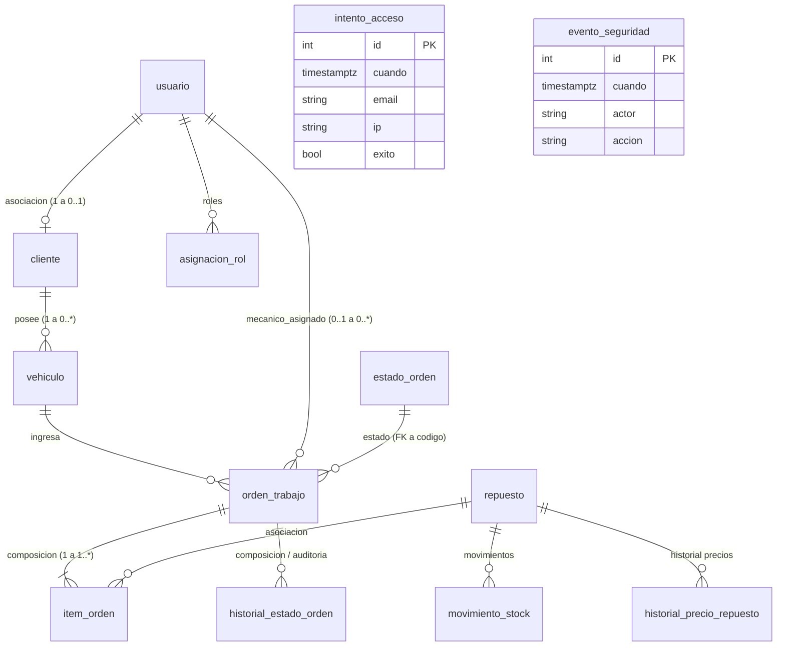

# Modelo de Datos

## Dominios del Sistema

1. **Usuarios y Accesos**: Autenticación, asignación dinámica de roles con vigencia, registro de intentos y auditoría.
2. **Clientes y Vehículos**: Fichas de clientes (con o sin usuario asociado) y flota de vehículos con soporte de borrado lógico y reasignación por venta.
3. **Inventario y Repuestos**: Catálogo de repuestos, trazabilidad inmutable de movimientos de stock y registro histórico de variaciones de precios.
4. **Órdenes de Trabajo**: Registro de ingresos por reparación, catálogo de estados de orden, composición de ítems y auditoría de transiciones de estado.

---

## ERD (Entity Relationship Diagram)

---

## Diccionario de Entidades y Tablas Obligatorias

> **IMPORTANTE**: Los nombres de tablas y columnas son estrictamente obligatorios según la consigna oficial.

### 1. `usuario`
- `id`: `int` (PK, autoincremental)
- `email`: `str` (UNIQUE, no nulo)
- `nombre`: `str` (no nulo)
- `password_hash`: `str` (hash bcrypt, no nulo)
- `activo`: `bool` (default `True`)
- `debe_cambiar_password`: `bool` (default `False`)
- `password_cambiada_en`: `timestamptz` (nulo permitido)

### 2. `asignacion_rol`
- `id`: `int` (PK, autoincremental)
- `usuario_id`: `int` (FK a `usuario.id`, no nulo)
- `rol`: `str` (CHECK: `ADMIN`, `RECEPCION`, `MECANICO`, `CLIENTE`)
- `desde`: `timestamptz` (no nulo)
- `vence_en`: `timestamptz` (nulo permitido)
- `revocada_en`: `timestamptz` (nulo permitido)
- `otorgada_por`: `int` (FK a `usuario.id`, nulo permitido)
- **Índice único parcial**: `UNIQUE (usuario_id, rol) WHERE revocada_en IS NULL`

### 3. `intento_acceso`
- `id`: `int` (PK, autoincremental)
- `cuando`: `timestamptz` (no nulo)
- `email`: `str` (no nulo)
- `ip`: `str` (no nulo)
- `exito`: `bool` (no nulo)
- **Índice**: `(email, ip, cuando)`

### 4. `evento_seguridad`
- `id`: `int` (PK, autoincremental)
- `cuando`: `timestamptz` (no nulo)
- `actor`: `str` (texto, ej: email o "SISTEMA")
- `accion`: `str` (descripción del evento)

### 5. `cliente`
- `id`: `int` (PK, autoincremental)
- `usuario_id`: `int` (FK a `usuario.id`, UNIQUE, nulo permitido para clientes sin cuenta web)
- `nombre`: `str` (no nulo)
- `documento`: `str` (UNIQUE, no nulo)
- `telefono`: `str` (no nulo)

### 6. `vehiculo`
- `id`: `int` (PK, autoincremental)
- `cliente_id`: `int` (FK a `cliente.id`, no nulo)
- `patente`: `str` (no nulo)
- `marca`: `str` (no nulo)
- `modelo`: `str` (no nulo)
- `anio`: `int` (CHECK: `anio BETWEEN 1950 AND 2100`)
- `borrado_en`: `timestamptz` (nulo permitido, borrado lógico)
- **Índice único parcial**: `UNIQUE (patente) WHERE borrado_en IS NULL`

### 7. `repuesto`
- `id`: `int` (PK, autoincremental)
- `codigo`: `str` (no nulo)
- `descripcion`: `str` (no nulo)
- `precio`: `NUMERIC(10,2)` (CHECK: `precio > 0`)
- `stock`: `int` (CHECK: `stock >= 0`)
- `borrado_en`: `timestamptz` (nulo permitido, borrado lógico)
- **Índice único parcial**: `UNIQUE (codigo) WHERE borrado_en IS NULL`

### 8. `estado_orden` (Catálogo de referencia)
- `codigo`: `str` (PK, clave primaria textual: `PENDIENTE`, `EN_REPARACION`, `TERMINADA`, `CANCELADA`)
- `descripcion`: `str` (no nulo)
- `posicion`: `int` (UNIQUE, orden lógico)
- `es_final`: `bool` (indica si el estado cierra la orden: `True` para `TERMINADA` y `CANCELADA`)

### 9. `orden_trabajo`
- `id`: `int` (PK, autoincremental)
- `vehiculo_id`: `int` (FK a `vehiculo.id`, no nulo)
- `mecanico_id`: `int` (FK a `usuario.id`, nulo permitido mientras esté pendiente)
- `estado`: `str` (FK a `estado_orden.codigo`, no nulo)
- `falla`: `str` (descripción de falla, no nulo)
- `creada_en`: `timestamptz` (no nulo)
- `total`: `NUMERIC(12,2)` (CHECK: `total >= 0`)

### 10. `item_orden` (Composición con orden_trabajo)
- `id`: `int` (PK, autoincremental)
- `orden_id`: `int` (FK a `orden_trabajo.id`, no nulo)
- `repuesto_id`: `int` (FK a `repuesto.id`, no nulo)
- `cantidad`: `int` (CHECK: `cantidad > 0`)
- `precio_unitario`: `NUMERIC(10,2)` (CHECK: `precio_unitario > 0`, copiado del repuesto al nacer la orden)
- **Restricción**: `UNIQUE (orden_id, repuesto_id)` (un repuesto no puede repetirse dentro de la misma orden)

### 11. `historial_estado_orden` (Sólo agregado)
- `id`: `int` (PK, autoincremental)
- `orden_id`: `int` (FK a `orden_trabajo.id`, no nulo)
- `desde_estado`: `str` (FK a `estado_orden.codigo`, nulo para el estado inicial)
- `hasta_estado`: `str` (FK a `estado_orden.codigo`, no nulo)
- `usuario_id`: `int` (FK a `usuario.id`, quien efectuó la transición)
- `cuando`: `timestamptz` (no nulo)
- **Protección**: Disparador rechaza `UPDATE` y `DELETE`.

### 12. `movimiento_stock` (Sólo agregado)
- `id`: `int` (PK, autoincremental)
- `repuesto_id`: `int` (FK a `repuesto.id`, no nulo)
- `orden_id`: `int` (FK a `orden_trabajo.id`, nulo permitido para reposiciones/altas)
- `usuario_id`: `int` (FK a `usuario.id`, no nulo)
- `cantidad`: `int` (CHECK: `cantidad <> 0`; positivo para ingresos, negativo para egresos)
- `motivo`: `str` (ej: "Stock inicial", "Reposicion", "Consumo orden #3")
- `cuando`: `timestamptz` (no nulo)
- **Protección**: Disparador rechaza `UPDATE` y `DELETE`.

### 13. `historial_precio_repuesto` (Sólo agregado)
- `id`: `int` (PK, autoincremental)
- `repuesto_id`: `int` (FK a `repuesto.id`, no nulo)
- `usuario_id`: `int` (FK a `usuario.id`, no nulo)
- `precio_anterior`: `NUMERIC(10,2)` (no nulo)
- `precio_nuevo`: `NUMERIC(10,2)` (CHECK: `precio_nuevo > 0` y `precio_nuevo <> precio_anterior`)
- `cuando`: `timestamptz` (no nulo)
- **Protección**: Disparador rechaza `UPDATE` y `DELETE`.

---

## Seed Data Inicial (`seed.py`)

Al ejecutarse `python seed.py`, se limpian las tablas y se insertan los siguientes datos canónicos requeridos por los casos de prueba:

1. **Catálogo de estados**:
   - `PENDIENTE` (posicion: 1, es_final: False)
   - `EN_REPARACION` (posicion: 2, es_final: False)
   - `TERMINADA` (posicion: 3, es_final: True)
   - `CANCELADA` (posicion: 4, es_final: True)
2. **Usuarios y roles**:
   - `admin@example.com` (rol `ADMIN`, sin vencimiento)
   - `admin2@example.com` (rol `ADMIN`, sin vencimiento)
   - `recepcion@example.com` (rol `RECEPCION`)
   - `mecanico@example.com` (rol `MECANICO`)
   - `mecanico2@example.com` (rol `MECANICO`)
   - `cliente@example.com` (rol `CLIENTE`)
   - `nuevo@example.com` (rol `MECANICO`, con `debe_cambiar_password = True`)
3. **Clientes y vehículos**:
   - Cliente **Laura** (asociada a `cliente@example.com`) con 2 vehículos (`AC456EF` y otro).
   - Cliente **Jorge** (sin usuario asociado) con 1 vehículo.
4. **Repuestos y stock inicial**:
   - Filtro de aceite: precio 8500.00, stock 10 (con movimiento "Stock inicial").
   - Pastillas de freno: precio 32000.00, stock 4.
   - Bujía: precio standard, stock 2.
   - Aceite por litro: precio 12000.00, stock 20.
5. **Órdenes de trabajo iniciales**:
   - Orden 1: `PENDIENTE`, primer vehículo de Laura.
   - Orden 2: `EN_REPARACION`, vehículo de Jorge, asignada a `mecanico@example.com`, pidiendo 4 bujías (habiendo solo 2 en stock).
6. **Históricos**:
   - Historial de precio del filtro de aceite (de 8000 a 8500).
   - Historial de seguridad: Fila inicial con actor `SISTEMA` ("Carga de los datos iniciales").
